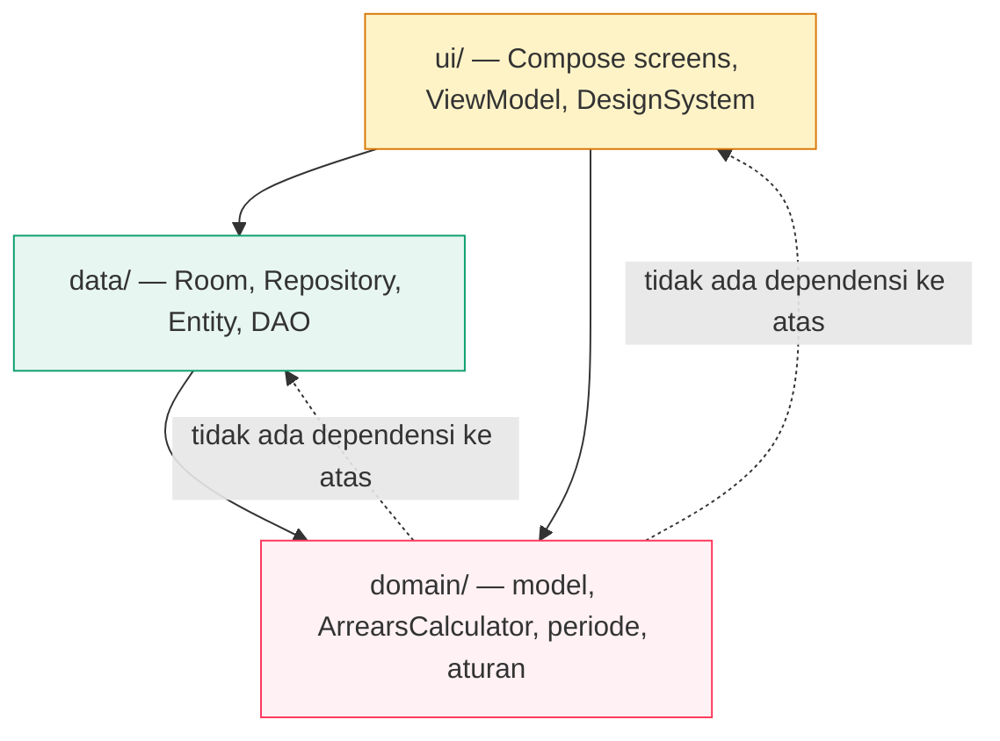
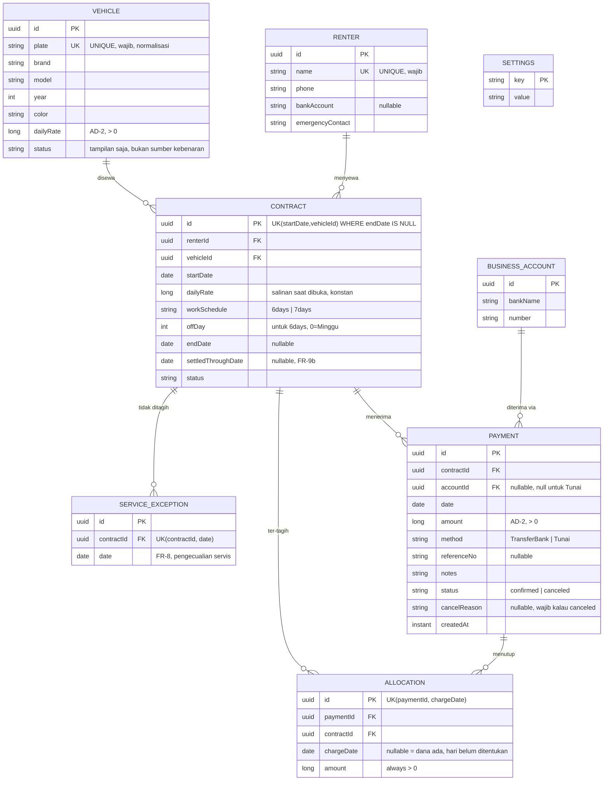

# Architecture Spine — Klinik.Net

## Design Paradigm

**Layered: `domain` → `data` → `ui`.** Ketiga lapis hanya boleh depend ke arah bawah. `domain` tidak tahu apa itu Android.



Batas `domain` adalah **yang membuat ini bisa diuji tanpa emulator** (AD-1). Aturan hitung tunggakan di sana — kalau tidak, mengujinya butuh dua menit startup emulator per iterasi, dan orang akan berhenti menguji.

Pemetaan ke direktori ada di Structural Seed.

## Invariants & Rules

### AD-1 — Domain layer tidak boleh tahu Android

- **Binds:** `all`, NFR-1, NFR-6, FR-10, FR-11
- **Prevents:** aturan hitung uang jadi tidak bisa diuji tanpa emulator; aturan bisnis tercampur dengan Compose atau Room
- **Rule:** `domain/` hanya boleh mengimpor `kotlin.*`, `java.time.*`, dan `kotlinx.coroutines.*`. Tidak boleh ada `android.*`, `androidx.*`, atau Room. Tipe domain (`RentalContract`, `Payment`, `DailyCharge`, `Period`) adalah data class murni — bukan entity Room, bukan `data class` yang_dialog dengan Compose.

  Room entity berada di `data/` dan **memetakan ke** tipe domain, bukan mewarisi atau membungkus langsung. Konsekuensi: test `ArrearsCalculatorTest` jalan dengan `./gradlew test` tanpa emulator, tanpa Android SDK terpasang.

### AD-2 — Nominal uang adalah `Long` dalam rupiah penuh, tidak pernah `Double`

- **Binds:** FR-1, FR-2, FR-3, FR-4, FR-10, FR-13, FR-14, NFR-6
- **Prevents:** error pembulatan floating point — Rp 100.000 bisa jadi Rp 99.999, dan tunggakan jadi angka yang mustahil dijelaskan ke penyewa
- **Rule:** seluruh nilai uang — tarif harian, nominal setoran, tunggakan, kredit — adalah `Long` dalam **rupiah penuh tanpa titik desimal**. Tidak ada `Double`, `Float`, atau tipe desimal untuk uang, di domain maupun di database. Kolom SQLite bertipe `INTEGER`.

  Format ke layar (`Rp 250.000`) terjadi di lapisan `ui/` saja, sebagai satu fungsi `formatRupiah()`. Tidak ada format yang di-hardcode di tempat lain.

### AD-3 — Tunggakan dihitung dari alokasi yang tersimpan, bukan dari penjumlahan ulang

- **Binds:** FR-10, FR-11, NFR-1, NFR-2
- **Prevents:** kredit Rp 13 juta hilang diam-diam; angka berubah sendiri saat cutoff atau tarif diubah
- **Rule:** setiap `Payment` menyimpan daftar hari tagih yang ditutupnya, di tabel `payment_allocation` (`paymentId`, `chargeDate`, `amount`). Tunggakan = `Kewajiban − Σ alokasi` untuk hari tagih di periode berjalan.

  Yang disimpan adalah **fakta** ("setoran ini menutup 23 Feb"), bukan hasil hitungan. Konsekuensi yang harus dipertahankan: kalau tarif diubah atau `cutoffDay` diganti, hitungan ulang otomatis konsisten karena ia membaca fakta yang sama. Model hitung-ulang-dari-awal dilarang.

  **Sisa yang belum ditempatkan tidak boleh hilang.** Kalau `amount` Setoran melebihi total Kewajiban periode berjalan, kelebihan itu **wajib** punya baris alokasi dengan `chargeDate = null` - penanda "dana ada, hari belum ditentukan". Baris bertanda NULL inilah yang membuat Kredit bertahan lintas periode; kalau tidak ada, Rp 13 juta hilang diam-diam di pergantian bulan.

  **Setiap mutasi menurunkan seluruh alokasi, tidak ada pengecualian.**
  - Pembatalan (FR-2) dan perubahan nominal (FR-3) **keduanya** menghapus semua baris alokasi milik Setoran itu, lalu menghitung ulang seluruh Kontrak dari semua Setoran yang tersisa. Satu `@Transaction`.
  - FR-9b ("tandai lunas sampai tanggal") **tidak** menulis baris alokasi - ia mengubah `settledThroughDate` pada Kontrak, dan motor hitung memperlakukannya sebagai hari tagih yang sudah tertutup tanpa menghasilkan Setoran.
  - Aturan tunggal yang harus selalu berlaku: jumlah allocation per Setoran selalu sama dengan `amount` Setoran itu, tanpa pengecualian. Kalau aturan ini dilanggar, itu bug - bukan kondisi yang sah.

### AD-4 - Semua tulisan ke Room terjadi dalam satu `@Transaction`, dan angka yang keluar tidak boleh terpecah

- **Binds:** NFR-2, FR-1, FR-2, FR-3, FR-7, FR-9, FR-9b, FR-15, FR-12
- **Prevents:** data setengah tertulis yang tidak bisa dipulihkan; nomor tunggakan yang dikomposisi dari beberapa pembacaan terpisah terkirim ke penyewa dalam keadaan setengah jadi
- **Rule (tulis):** operasi yang menyentuh lebih dari satu baris - atau satu baris yang memengaruhi hitungan - dijalankan lewat `@Transaction` pada suspend function Repository. Repository API **tidak pernah** mengekspos `Dao` ke lapisan `ui/`. Tidak ada `Flow` yang menulis.

  Setiap error menulis memunculkan gagal-keras: **jangan** me-reset ke default saat parsing gagal. Damage yang lebih besar dari data hilang adalah data hilang yang terlihat seperti akun baru.

  **Rule (baca, untuk angka yang dikirim ke luar):** angka yang dikirim ke penyewa lewat WhatsApp (FR-12) harus berasal dari **satu** pembacaan snapshot yang mengembalikan objek lengkap per Kontrak (`ArrearsSummary`), bukan dari tiga query terpisah yang digabung di layar.

  Kalau layar Tunggakan menyusun sisa tunggakan dari "baca tunggakan + baca hari + baca nama" dalam tiga pembacaan terpisah, dan ada cancel yang jalan di antaranya, nomor yang tampil bisa berasal dari dua keadaan berbeda - dan nomor itu terkirim ke pelanggan tanpa ada undo dan tanpa jejak audit. Layar Tunggakan dan compose pesan WhatsApp memakai objek `ArrearsSummary` yang **sama**, bukan menghitung ulang.

### AD-5 - Tampilan selalu membaca hasil hitungan yang sama

- **Binds:** FR-13, FR-14, NFR-1
- **Prevents:** Beranda dan Laporan menampilkan angka berbeda untuk hal yang sama - pengguna berhenti percaya pada aplikasi
- **Rule:** semua angka yang sama berasal dari **satu** fungsi di `domain/`, diekspos lewat **satu** query Room yang mengembalikan baris agregat. Beranda dan Laporan tidak punya perhitungan sendiri, dan tidak punya reader sendiri.

  **Tidak ada sinyal invalidasi manual.** Room sudah punya `InvalidationTracker` yang otomatis mengemisi ulang `Flow` setiap kali tabel yang diamati berubah. Menambahkan `repository.invalidate()` manual di sampingnya menghasilkan **dua mekanisme refresh** yang bisa berbeda - persis bug angka tidak sinkron yang AD-5 ada untuk cegat. Jangan pakai sinyal manual untuk data Room.

  State di UI dibentuk dengan `combine` + `stateIn` + `distinctUntilChanged()` di atas `Flow` Room, bukan pemicu manual.

  **Dua titik waktu, bukan dua fungsi.** FR-13 butuh "Tunggakan aktif" per hari ini; FR-14 butuh "Tunggakan akhir periode". Keduanya dari fungsi yang sama dengan **parameter titik waktu berbeda** (`asOf: LocalDate`), bukan dua fungsi terpisah yang bisa menyimpang.

  Aturan warna: badge tunggakan **diturunkan** dari angka hari, tidak pernah dipilih manual. (EXPERIENCE.md §4)

### AD-6 — Ekspor dan pemulihan lewat Storage Access Framework, tanpa storage permission

- **Binds:** FR-16, NFR-2, NFR-3
- **Prevents:** permintaan izin storage yang tidak perlu; pickup file yang tidak bisa dikendalikan pengguna
- **Rule:** ekspor pakai `ActivityResultContracts.CreateDocument` (user pilih lokasi), pemulihan pakai `OpenDocument`. **Tidak ada** `MANAGE_EXTERNAL_STORAGE` atau `READ_EXTERNAL_STORAGE` di manifest.

  Berkas ekspor memuat `schemaVersion` di root. Pemulihan dari versi yang lebih baru ditolak dengan pesan jelas — bukan dengan kegagalan parsing yang menghapus data yang ada.

### AD-7 — PIN adalah penghalang layar dengan kode pemulihan, dan tidak ada klaim lain

- **Binds:** FR-17, NFR-5
- **Prevents:** lockout permanen setelah pemulihan data; klaim keamanan yang tidak ada; hash PIN yang bocor ke berkas cadangan
- **Rule:**

  **Hashing.** PIN **tidak** memakai bcrypt atau Argon2. Keduanya tidak ada di Android SDK tanpa dependency native, dan untuk PIN 4-digit (10.000 kombinasi) keduanya justru memperlambat unlock pemilik tanpa menambah keamanan nyata terhadap penyerang offline. Yang dipakai adalah **PBKDF2WithHmacSHA1** dengan salt acak per-pengaturan dan iterasi yang cukup, yang tersedia sejak API 10 tanpa library tambahan.

  **Kode pemulihan.** Saat PIN dibuat, aplikasi **membuat satu kode pemulihan** berentropi jauh lebih tinggi — alphanumeric, bukan angka, minimal 20 karakter — dan menampilkannya **sekali**. Hash kode disimpan; kode plaintext tidak pernah disimpan. Kode inilah yang dipakai untuk mengatur PIN baru saat PIN terlupa.

  **Kode pemulihan wajib disimpan oleh pemilik di luar aplikasi.** Aplikasi meminta konfirmasi bahwa ini sudah dicatat sebelum flow selesai. Entropinya harus jauh di atas PIN — kalau kodenya 4–6 digit, ia hanya PIN dengan langkah tambahan dan bisa ditebak.

  **Yang tidak ikut ekspor.** Hash PIN dan hash kode pemulihan **tidak** masuk berkas ekspor (lihat AD-6 dan FR-16). Setelah pemulihan, `pinEnabled` kembali ke `false` dan aplikasi jelas meminta pemilik mengatur PIN baru. Konsekuensi yang diterima: cadangan tidak menyalin kunci layar — kalau tidak, hash-nya akan tersebar ke setiap salinan berkas, dan itu persis kebocoran yang NFR-5 coba cegat.

  **Rate limiting.** Setelah 5 percobaan gagal beruntun, kunci layar menolak input dan menampilkan hitung mundur. Ini adalah kontrol yang benar untuk PIN berentropi rendah — bukan biaya hash.

  **Timestamp, bukan counter.** Waktu kunci otomatis disimpan sebagai **timestamp absolut** saat aplikasi masuk background, bukan counter yang reset — harus bertahan lewat proses mati dan restart perangkat.

  **Tidak ada klaim lain.** Setiap teks UI dan dokumentasi menyatakan PIN sebagai penghalang, bukan keamanan. Prototipe menulis "data tersimpan lokal dan terenkripsi" — kalimat itu **tidak boleh** dipakai ulang (FR-17).

### AD-8 — `LocalDate.now()` adalah satu-satunya sumber "hari ini"

- **Binds:** all
- **Prevents:** prototipe memakai konstanta simulasi `SIM_TODAY`; data uji yang tidak mencerminkan hari nyata
- **Rule:** tidak ada konstanta tanggal hardcoded di mana pun. Semua "hari ini" lewat satu `Clock` abstraction di `domain/` yang default-nya `LocalDate.now()`. Test menyuntik tanggal tetap lewat `Clock` — **bukan** lewat konstanta global.

### AD-9 — Navigasi didorong orientasi, bukan dua aplikasi terpisah

- **Binds:** NFR-9, EXPERIENCE.md §2
- **Prevents:** landscape dan portrait lahir jadi dua basis kode yang berbeda dan mulai menyimpang
- **Rule:** **satu** Activity, **satu** NavHost. `WindowSizeClass` menentukan apakah rail + master-detail dirender, atau bottom-nav + single-column. NavController dan graph identik di kedua orientasi — hanya komposisi layout yang berbeda. Tidak ada branch pada logika bisnis berdasarkan orientasi.

## Consistency Conventions

| Concern | Convention |
| --- | --- |
| Naming (entities, files, events) | Entity Room `PascalCase` singular (`RentalContract`). Tipe domain **tanpa** suffix `Entity` — entitas yang sama punya dua representasi (`data/entity/ContractEntity.kt` → `domain/model/Contract.kt`). Penamaan file mengikuti layer: ArrearsCalculator.kt di domain/calculate/. |
| IDs | `UUID` untuk semua primary key, **tipe domain**. Room 2.8 punya konverter UUID bawaan, jadi tidak ada kode konverter. Alasan sebenarnya: pemulihan dari backup tidak akan pernah menyebabkan tabrakan ID atau perlu pemetaan ulang foreign key. (Impor data bukan alasannya — PRD §6.2 mengeluarkannya dari scope.) |
| Tanggal | `LocalDate` untuk tanggal tanpa waktu, `Instant` hanya untuk `createdAt`/`canceledAt`. Tidak ada `Date` atau `Timestamp`. Disimpan sebagai **TEXT ISO `yyyy-MM-dd`** — urutan leksikografis = kronologis, jadi bisa di-sort dan di-index. Room 2.8 tidak punya dukungan `java.time` bawaan, jadi `Converters.kt` memang dibutuhkan. Jangan "mengoptimalkan" ke integer nanti. |
| Format rupiah | Satu fungsi `formatRupiah(Long): String` di `ui/format/`. Dipanggil semua tempat. Tidak ada template literal yang menyusun angka secara manual. |
| Parse rupiah | Satu fungsi `parseRupiahInput(String): Long?` di **layer terendah** — bukan di `ui/`, karena AD-1 melarang `data/` melihat `ui/`, dan NFR-6 butuh validasi yang sama di kedua sisi. **Tidak ada nilai default diam-diam**: input invalid mengembalikan `null` dan ditolak, tidak pernah jatuh ke angka bawaan. Ini persis mode gagal `parseInt(x) \|\| 250000` yang ditemukan di prototipe. |
| Error | Domain melempar tipe spesifik yang sudah jelas: `InvalidAmountException`, `DuplicatePlateException`, `ContractAlreadyActiveException`. Lapisan `data` menerjemahkannya ke pesan dalam Bahasa Indonesia. Tidak ada `Result<_, String>` dengan pesan dari domain — pesan adalah urusan UI. |
| Mutasi | Semua lewat `Repository` suspend function. Tidak ada setter yang langsung. Room mengelola invalidasi otomatis (AD-5). |
| State di UI | Satu `UiState` data class per layar, exposing `StateFlow`. Loading state berupa skeleton, bukan spinner (EXPERIENCE.md §5). |
| Config | Cutoff day, auto-lock, identitas usaha, rekening usaha — semua di Room (`settings` table), **bukan** DataStore, supaya ikut tercakup backup/restore (FR-16). PIN dan kode pemulihan **tidak** ikut ekspor (AD-7). `settings.value` bertipe `String` dan **tidak boleh** menyimpan nilai uang — AD-2 hanya berlaku pada kolom `Long`. |
| Ikon | Lucide via `com.composables:icons-lucide`. Import `com.composables.icons.lucide.Lucide`. Tidak ada Material Icons. |
| Bahasa | Semua string UI Bahasa Indonesia, di `ui/strings/`. Tidak ada `res/values/strings.xml` yang berisi teks hardcode — hanya nama yang akan diterjemahkan. |
| Logging | Tidak ada log yang memuat nominal, nama penyewa, PIN, atau kode pemulihan. Kalau dipakai, hanya nilai enum dan id. |

## Stack

Diverifikasi terhadap sumber live, 2026-10-13. Toolchain lokal sudah diverifikasi terpisah (JDK 25.0.3, SDK 34-37).

| Name | Version |
| --- | --- |
| AGP | 9.4.1 |
| Gradle | 9.8.1 |
| Kotlin | 2.3.21 |
| Kotlin Android plugin | **Tidak dipasang** — AGP 9 punya Kotlin bawaan |
| Compose compiler plugin | 2.3.21 (harus sama dengan Kotlin) |
| Compose BOM | 2026.09.00 |
| Room | 2.8.5 |
| KSP | 2.3.12 |
| Lifecycle | 2.11.0 |
| Navigation Compose | 2.10.2 |
| Activity Compose | 1.13.0 |
| Core KTX | 1.19.1 |
| Icons (Lucide) | `com.composables:icons-lucide:1.0.0` |
| compileSdk | 37 |
| targetSdk | 36 |
| minSdk | 24 |
| JVM target | 17 (`kotlin { jvmToolchain(17) }`) |
| Core library desugaring | `com.android.tools:desugar_jdk_libs:2.1.5` — **wajib**, bukan opsional |

**Version pin yang punya alasan:**

- **Kotlin 2.3.21, bukan 2.4.x.** KSP 2.3.12 hanya mendukung KGP 2.2.10–2.3.x. 2.3.21 adalah kombinasi yang terdokumentasi penuh.
- **Compose compiler = versi Kotlin.** Tidak boleh berbeda; tidak dikoreksi otomatis.
- **minSdk 24.** Room 2.8 menaikkan floor ke 23; 24 memberi margin tanpa biaya.

**Jebakan yang sudah diketahui (sudah tercatat di memlog, tapi dituliskan di sini karena builder berikutnya tidak akan membacanya):**

- **Core library desugaring WAJIB aktif.** `java.time` (`LocalDate`, `Instant`) baru tersedia sejak **API 26**. Dengan `minSdk 24`, `LocalDate.now()` melempar `NoClassDefFoundError` di Android 7 — aplikasi crash saat startup, bukan error halus. Butuh `compileOptions.isCoreLibraryDesugaringEnabled = true` **dan** `coreLibraryDesugaring("com.android.tools:desugar_jdk_libs:2.1.5")`. Tanpa ini, seluruh spine runtuh karena AD-8 tidak bisa jalan.
- Memasang `org.jetbrains.kotlin.android` pada AGP 9 = **hard build failure**, bukan deprecation: `Cannot add extension with name 'kotlin'`. Semua tutorial lama akan salah di sini.
- `composeOptions.kotlinCompilerExtensionVersion` **dihapus**. Wajib plugin `org.jetbrains.kotlin.plugin.compose`.
- `kotlinOptions {}` **dihapus** pada AGP 9. Gunakan `kotlin { compilerOptions { } }`.
- Gradle bisa jalan di JVM 25 (lokal), tapi **compile ke 17**. Tanpa `jvmToolchain(17)`, JDK lokal bocor ke compile target.
- **`./gradlew test` tidak bisa jalan tanpa Android SDK terpasang.** AGP gagal saat *configuration time* dengan "SDK location not found" — bukan hanya saat runtime test. Emulator-free itu benar; SDK-free itu **tidak**. Karena itu `domain/` dipisah jadi modul Gradle pure-JVM (lihat Structural Seed).

**Domain sebagai modul terpisah — bukan sekadar package.** AD-1 ditegakkan oleh Gradle, bukan oleh disiplin:

```kotlin
// domain/build.gradle.kts — tidak punya android {} block sama sekali
plugins { kotlin("jvm") }
dependencies { testImplementation(kotlin("test")) }
```

Ini bukan sekadar soal kebersihan arsitektur. Kalau `domain/` bisa meng-import `android.*`, aturan itu akan dilanggar di review pertama tanpa ada yang menangkap. Kalau `domain/` adalah modul pure-JVM, Gradle yang menegakkan AD-1 - impor Android jadi build failure, bukan teguran di review. Dan `./gradlew :domain:test` jalan tanpa SDK sama sekali.

## Structural Seed

**Dua modul, bukan satu.** `domain` pure-JVM (AD-1 ditegakkan Gradle, test jalan tanpa SDK), `app` Android.

```text
domain/                            # modul Gradle pure-JVM — TIDAK punya android {}
  build.gradle.kts                 # plugins { kotlin("jvm") }
  src/main/kotlin/net/klinik/rental/domain/
    model/                         # Contract, Payment, Renter, Vehicle, DailyCharge, ArrearsSummary
    calculate/                     # ArrearsCalculator, CutoffPeriod, AllocationEngine
    validation/                    # exception types
    Clock.kt                       # AD-8

app/                               # modul Android
  build.gradle.kts                 # desugaring WAJIB — lihat Stack
  src/main/kotlin/net/klinik/rental/
    data/
      db/
        KlinikDatabase.kt
        entity/                    # ContractEntity, PaymentEntity, AllocationEntity, ServiceExceptionEntity
        dao/                       # ArrearsDao (query snapshot — AD-4 aturan baca)
        Converters.kt              # LocalDate <-> ISO TEXT (Room 2.8 tidak punya bawaan)
      repository/
        RentalRepository.kt        # AD-4 — satu-satunya jalan ke data
      backup/
        BackupSerializer.kt        # schemaVersion, AD-6
    ui/
      designsystem/                # token DESIGN.md: BrandColor, Typography, Spacing
      navigation/                  # NavHost graph, AppRail, BottomBar — AD-9
      screens/
        beranda/                   # HomeScreen + HomeViewModel
        setoran/                   # PaymentScreen + dialog pratinjau alokasi
        tunggakan/                 # ArrearsScreen — memakai ArrearsSummary, tidak menghitung ulang
        kendaraan/ penyewa/ laporan/ pengaturan/
      format/                      # formatRupiah (AD-2)
      strings/                     # Bahasa Indonesia
    MainActivity.kt                # satu Activity, WindowSizeClass di sini — AD-9

domain/src/test/kotlin/...         # 7 kasus verify-fr10.md — jalan tanpa SDK
```

### ERD



**Indeks di atas bukan dekorasi — sebagian adalah koreksi.**
- `VEHICLE.plate UNIQUE` dan `RENTER.name UNIQUE` adalah **persyaratan NFR-6**: input buruk harus ditolak di lapisan data, bukan hanya di UI. Kalau uniqueness hanya dicek di antarmuka, dua layar bisa melewati pengecekan yang sama.
- `ALLOCATION UNIQUE(paymentId, chargeDate)` adalah **koreksi kebenaran**, bukan performa — tanpa itu, satu Setoran bisa punya dua baris untuk hari yang sama dan `Σ allocation` melebihi `amount`.
- `CONTRACT` active uniqueness (satu Kontrak aktif per Kendaraan *dan* per Penyewa, FR-7) ditegakkan lewat partial unique index, bukan konvensi.
- `SETTINGS.value` bertipe `String`, jadi **tidak boleh dipakai menyimpan nilai uang** — AD-2 hanya berlaku pada kolom bertipe `Long`.

**`ALLOCATION` adalah tabel yang membuat AD-3 mungkin.** Tanpa itu, kredit lintas periode hilang. Tidak opsional.

## Capability → Architecture Map

| Capability / Area | Lives in | Governed by |
| --- | --- | --- |
| Hitung tunggakan, alokasi, kredit | `domain/calculate/` | AD-1, AD-2, AD-3 |
| Periode cutoff, hari kerja | `domain/calculate/CutoffPeriod.kt` | AD-1, AD-8 |
| Kelola Kendaraan | `data/` + `ui/screens/kendaraan/` | AD-2, AD-4 |
| Kelola Penyewa | `data/` + `ui/screens/penyewa/` | AD-4 |
| Kontrak (buka/akhiri/tandai lunas) | `domain/` + `data/repository/` | AD-3, AD-4 |
| Pengecualian Servis (FR-8) | `data/entity/ServiceExceptionEntity` + `domain/calculate/` | AD-1, AD-4 |
| Setoran (catat/batal/koreksi) | `data/repository/` + `ui/screens/setoran/` | AD-2, AD-3, AD-4 |
| Pratinjau alokasi sebelum simpan | `domain/calculate/` (dipanggil dialog) | AD-3, EXPERIENCE.md §4 |
| Tunggakan & pesan WhatsApp | `ui/screens/tunggakan/` | AD-5, AD-7 |
| Beranda & Laporan | `domain/` (sumber tunggal) → kedua layar | AD-5 |
| Ekspor / pemulihan | `data/backup/` + `ui/screens/pengaturan/` | AD-6 |
| Kunci layar PIN + kode pemulihan | `data/` (settings) + `ui/` (gate) | AD-7 |
| Pratinjau Tunggakan untuk WhatsApp | satu snapshot query di `data/` + `domain/calculate/` | AD-3, AD-4, AD-5 |
| Identitas usaha & rekening | `data/` + `ui/screens/pengaturan/` | AD-6, AD-7 |
| Pencarian global | `data/repository/` (query) + `ui/` | AD-4 |
| Navigasi & layout responsif | `ui/navigation/` | AD-9 |
| Design token | `ui/designsystem/` | EXPERIENCE.md |

## Test Strategy

Minimal — 7 test, satu per kasus di `verify-fr10.md`. Ini **satu-satunya** tempat di aplikasi yang bisa merugikan uang orang lain; sisanya form dan navigasi yang tidak punya mode gagal diam-diam.

Semua di **modul `domain/`**, jadi `./gradlew :domain:test` jalan tanpa Android SDK sama sekali — bukan sekadar tanpa emulator.

| # | Kasus | Yang diuji |
| --- | --- | --- |
| 1 | Bayar 2 hari sekaligus | Alokasi menutup 2 hari tertua |
| 2 | Bayar hari Minggu (off-day) | Setoran tetap dikreditkan — **regresi bug prototipe** |
| 3 | Bayar sebagian | Alokasi parsial, hari tersisa benar |
| 4 | Bayar buat 2 bulan | Kredit bertahan lintas periode — **regresi temuan verifikasi** |
| 5 | Kontrak backdated + tandai lunas | FR-9b menutup semua hari lewat |
| 6 | Pembatalan | Alokasi dilepas, tunggakan naik |
| 7 | Setoran bertanggal reddit | Tidak dihitung sebelum jatuh tempo |

Tambahan yang wajib ada: `DuplicatePlateException` dan `dailyRate <= 0` ditolak (AD-2, NFR-6).

## Deferred

| Keputusan | Kenapa bisa menunggu | Kapan tidak bisa menunggu |
| --- | --- | --- |
| **Multi-user, sinkronisasi** | PRD §5: satu pengguna, satu tablet, satu perangkat. Selalu satu pemilik. | Kalau pernah ada yangelse yang butuh akses. |
| **Pengeluaran / cicilan / biaya servis** | PRD §6.2: sudah diputuskan pemilik ditunda. Butuh model data baru (`Expense`), bukan sekadar field baru. | Kalau keputusan modal jadi perlu angka dari aplikasi, bukan dari kepala. |
| **Ekspor PDF / laporan tercetak** | Laporan untuk monitoring internal; ekspor JSON sudah cukup. | Kalau laporan perlu dibagikan ke pihak lain. |
| **Bank / QRIS integration** | PRD §5: rekonsiliasi manual di m-banking sudah cukup. | Kalau jumlah transaksi per hari membuat manual tidak sustainable. |
| **Riwayat perubahan Setoran (versioning)** | PRD FR-3: satu Setoran punya satu nilai terkini. | Kalau perlu audit "siapa ubah dari apa", dan kapan. Saat ini pembatalan cukup. |
| **Widget / notifikasi harian** | PRD §6.2 v2. | Kalau user ternyata sering lupa cek aplikasi. |
| **Izin storage manual** | AD-6: SAF cukup, dan lebih aman. | Tidak ada kondisi yang membutuhkannya — kalau ada, means SADALAH salah. |

---

*Rationale ada di `.memlog.md`. Rujukan: `prd.md`, `verify-fr10.md`, `DESIGN.md`, `EXPERIENCE.md`.*
